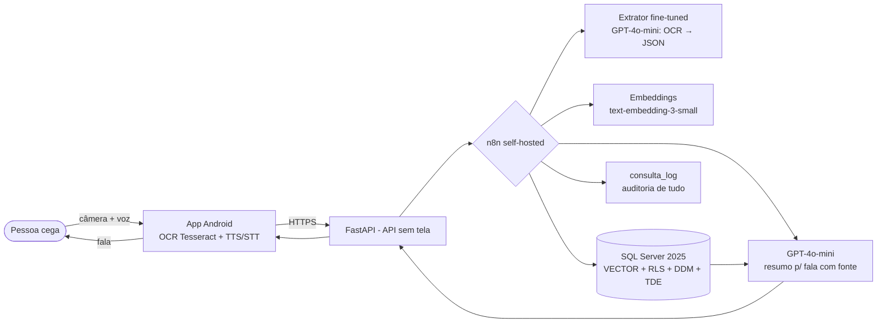

# GuiaMed 💊🔊

**Grupo GuiaMed** — **Componentes:** João Roberto Santos Cardoso (231070711) · Gabriel de Souza Nascimento (231071404) · Daniel Queiroga Santana Martins (231070654)
**Disciplinas:** Projeto de Inteligência Artificial + Segurança e Otimização de BD (entrega completa nas duas)

## O que é

**App de acessibilidade por voz para pessoas com deficiência visual ou baixa visão severa.** A pessoa aponta a câmera do celular para a **embalagem do remédio** ou para uma **receita digitalizada**, e o app responde **em voz**: que remédio é, para que serve, como tomar — e **alerta em voz alta** se o remédio conflita com as **alergias** cadastradas pela própria voz.

- **Problema:** quem não enxerga (ou enxerga pouco) não consegue ler bula, embalagem nem receita. Erro de medicamento nesse público não é inconveniente — é risco de vida.
- **O que muda quando funciona:** autonomia. A pessoa identifica o remédio em mãos em segundos, sem depender de terceiros, com a informação vindo **somente de bulas cadastradas** (fictícias, ver [`docs/dados.md`](docs/dados.md)) — sem fonte, sem resposta.
- **Interface:** app Android "zero interface" (tela = câmera, comandos por toques + voz/TTS) falando com uma **API sem tela** — formato permitido pelo enunciado; não é SaaS nem site. O GuiaMed **não** dá diagnóstico nem substitui médico/farmacêutico.

## Arquitetura (resumo)



Diagrama completo (IA + dados + segurança): [docs/arquitetura.md](docs/arquitetura.md)

## Canvas de uma página

| Bloco | Conteúdo |
|---|---|
| Problema / usuário | Pessoa cega não lê embalagem/receita; risco de remédio errado ou alergia |
| Entrada | Foto da embalagem/receita (OCR no celular) + comandos de voz |
| Saída | Voz (TTS): remédio, indicação, posologia + **alerta de alergia**; sempre citando a bula |
| Arquitetura | App voz/OCR → API → n8n → extrator fine-tuned → RAG (SQL Server VECTOR) → GPT-4o-mini → voz → log |
| Maior risco | IA identificar o remédio errado a partir de OCR ruidoso → mitigado por fine-tuning + confiança mínima + pós-checagem |
| Versão mínima (3 semanas) | Apontar a câmera → ouvir nome/indicação/posologia das 24 bulas, com alerta de alergia, log e RLS ativos |

Canvas completo: [docs/canvas.md](docs/canvas.md)

## Estrutura

```
backend/            API FastAPI real do app (verificar, alergias, receitas)
data/bulas.json     base de 24 bulas FICTÍCIAS (fonte única do RAG)
data/bulas_md/      mesmas bulas em Markdown (documentos do RAG)
data/ft/            amostra do dataset de fine-tuning (extrator de OCR)
db/01_ddl.sql       criação do banco, tabelas, índices, procedures
db/02_security.sql  papéis, GRANT/DENY, RLS, mascaramento, TDE
db/03_seed.sql      carga inicial (gerado — 24 medicamentos, 144 chunks)
db/04_volume.sql    geração de massa p/ otimização (1M logs, 50k vetores)
db/05_seed_app.sql  dados demo do app (dispositivo, alergias, receita)
docs/               canvas, arquitetura, segurança, dados, ataques, apresentação
```

## Setup rápido (dev)

```powershell
# 1) Banco: SQL Server 2025 em Docker
docker run -e "ACCEPT_EULA=Y" -e "MSSQL_SA_PASSWORD=<DefinaUmaSenhaForte!Aqui>" -p 1433:1433 -d --name guiamed-sql mcr.microsoft.com/mssql/server:2025-latest

# 2) Criar, popular e proteger (nesta ordem, via sqlcmd ou Azure Data Studio):
#    db/01_ddl.sql -> db/03_seed.sql -> db/05_seed_app.sql -> db/02_security.sql
#    (regerar o seed: python scripts/generate_seed.py)

# 3) Embeddings: pip install openai pyodbc && set OPENAI_API_KEY=... (nunca no repo!)
#    python scripts/embed_chunks.py

# 4) API: cd backend && pip install -r requirements.txt && python main.py
#    (credenciais via .env — ver backend/.env.example; NUNCA commitar .env)

# 5) n8n: docker run -p 5678:5678 -d n8nio/n8n  → importar fluxo descrito em docs/arquitetura.md
```

> Nota: o protótipo mobile do backend usa PostgreSQL; para a disciplina o modelo foi padronizado em **SQL Server 2025** (tipo `VECTOR` nativo + RLS/DDM/TDE), conforme opções do enunciado. O desenho é equivalente.

## Documentos da entrega

| Documento | Conteúdo |
|---|---|
| [ENTREGA.md](ENTREGA.md) | Documento mestre com todas as partes exigidas |
| [docs/canvas.md](docs/canvas.md) | Canvas de uma página (completo) |
| [docs/arquitetura.md](docs/arquitetura.md) | Diagrama único IA+dados, fluxo n8n, RAG, fine-tuning |
| [docs/dados.md](docs/dados.md) | Base de 24 documentos, origem e declaração de ficção |
| [docs/seguranca.md](docs/seguranca.md) | Modelo classificado, matriz de papéis, ameaças, otimização |
| [docs/ataques.md](docs/ataques.md) | Plano de testes: prompt injection pela câmera + SQL injection |
| [docs/apresentacao.md](docs/apresentacao.md) | Roteiro da apresentação parcial (5 min) |
