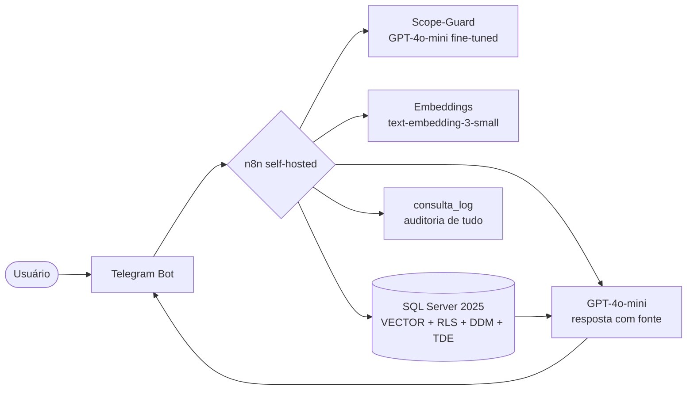

# GuiaMed 💊

**Grupo GuiaMed** — **Componentes:** João Roberto Santos Cardoso (231070711) · Gabriel de Souza Nascimento (231071404) · Daniel Queiroga Santana Martins (231070654)
**Disciplinas:** Projeto de Inteligência Artificial + Segurança e Otimização de BD (entrega completa nas duas)

## O que é

**Bot de Telegram que responde dúvidas de pacientes sobre medicamentos** (para que serve, como tomar, contraindicações, interações) usando **apenas bulas cadastradas** — sem inventar: se não está na bula, o bot não responde.

- **Problema:** paciente leigo não entende bula de papel; lê dosagem errada ou mistura remédios com interação perigosa.
- **O que muda quando funciona:** resposta confiável em linguagem simples, em segundos, direto no Telegram, com a fonte (bula + seção) citada em toda resposta.
- **Importante:** todos os medicamentos da base são **fictícios** ([detalhes](docs/dados.md)). O GuiaMed **não** dá diagnóstico nem substitui médico/farmacêutico.

## Arquitetura (resumo)



Diagrama completo (IA + dados + segurança): [docs/arquitetura.md](docs/arquitetura.md)

## Canvas de uma página

| Bloco | Conteúdo |
|---|---|
| Problema / usuário | Paciente leigo com dúvida sobre remédio; risco de automedicação errada |
| Entrada | Pergunta em texto livre no Telegram |
| Saída | Resposta em linguagem simples + citação (medicamento, seção) + aviso de tarja |
| Arquitetura | Telegram → n8n → Scope-Guard → RAG (SQL Server VECTOR) → GPT-4o-mini → log |
| Maior risco | Alucinação / resposta fora da bula → mitigado por RAG obrigatório + pós-checagem |
| Versão mínima (3 semanas) | Bot respondendo posologia/indicação de 24 bulas com fonte, log no banco e RLS ativa |

## Estrutura

```
data/bulas.json      base de 24 bulas FICTÍCIAS (fonte única)
data/bulas_md/       mesmas bulas em Markdown (documentos do RAG)
data/ft/             amostra do dataset de fine-tuning (scope-guard)
db/01_ddl.sql        criação do banco, tabelas, índices, procedures
db/02_security.sql   papéis, GRANT/DENY, RLS, mascaramento, TDE
db/03_seed.sql       carga inicial (gerado — 24 medicamentos, 144 chunks)
db/04_volume.sql     geração de massa p/ otimização (1M logs, 50k vetores)
scripts/             gerador do seed + preenchimento de embeddings
docs/                canvas, arquitetura, segurança, dados, ataques, apresentação
```

## Setup rápido (dev)

```powershell
# 1) Banco: SQL Server 2025 em Docker
docker run -e "ACCEPT_EULA=Y" -e "MSSQL_SA_PASSWORD=<DefinaUmaSenhaForte!Aqui>" -p 1433:1433 -d --name guiamed-sql mcr.microsoft.com/mssql/server:2025-latest

# 2) Criar, popular e proteger (nesta ordem, via sqlcmd ou Azure Data Studio):
#    db/01_ddl.sql -> db/03_seed.sql -> db/02_security.sql
#    (regerar o seed se preciso: python scripts/generate_seed.py)

# 3) Embeddings: pip install openai pyodbc && set OPENAI_API_KEY=... (nunca no repo!)
#    python scripts/embed_chunks.py

# 4) n8n: docker run -p 5678:5678 -d n8nio/n8n  → importar fluxo descrito em docs/arquitetura.md
```

## Documentos da entrega

| Documento | Conteúdo |
|---|---|
| [ENTREGA.md](ENTREGA.md) | Documento mestre com todas as partes exigidas |
| [docs/canvas.md](docs/canvas.md) | Canvas de uma página (completo) |
| [docs/arquitetura.md](docs/arquitetura.md) | Diagrama único IA+dados, fluxo n8n, RAG, fine-tuning |
| [docs/dados.md](docs/dados.md) | Base de 24 documentos, origem e declaração de ficção |
| [docs/seguranca.md](docs/seguranca.md) | Modelo classificado, matriz de papéis, ameaças, otimização |
| [docs/ataques.md](docs/ataques.md) | Plano de testes: prompt injection + SQL injection |
| [docs/apresentacao.md](docs/apresentacao.md) | Roteiro da apresentação parcial (5 min) |
