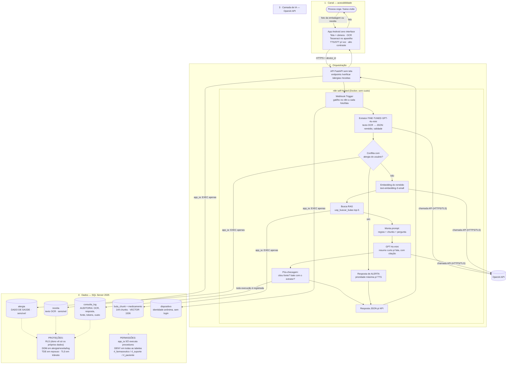

# Arquitetura — GuiaMed (diagrama único IA + dados)

Diagrama único exigido pela **Parte de integração**: banco ligado ao LLM, ao RAG e ao n8n, mostrando onde ficam **permissões (RBAC)**, **proteção de dados** e **auditoria**.

## Componentes (o que cada caixa faz e por quê)

| Componente | Escolha | Por quê |
|---|---|---|
| Interface | **App Android por voz** (CameraX + Tesseract + TTS/STT) falando com **API sem tela** (FastAPI) | O usuário-alvo **não enxerga a tela**: voz é o requisito, não luxo. OCR no aparelho = funciona com internet lenta e não envia imagem para fora. "API sem tela" é formato permitido pelo enunciado |
| Orquestração | **n8n self-hosted** (Docker) | Exigido pela disciplina; gratuito; nós nativos de webhook, OpenAI e SQL Server; cada execução vira registro auditável |
| LLM principal | **GPT-4o-mini** | Gera o resumo em linguagem simples para ser falado em até ~30s — ver justificativa e custo abaixo |
| Extrator | **GPT-4o-mini fine-tuned** | Converte texto OCR ruidoso em JSON `{nome_comercial, principio_ativo, validade}` — ver experimento abaixo |
| Embeddings | **text-embedding-3-small** (1536 dims) | Mais barato da OpenAI; qualidade suficiente para 144–200 chunks |
| Banco / vetorial | **SQL Server 2025** (`VECTOR` + `VECTOR_DISTANCE`) | Um banco só para bulas, alergias, receitas, vetor e auditoria; atende à disciplina (TDE, DDM, RLS nativos). Protótipo dev do app usava PostgreSQL; modelo padronizado aqui em SQL Server conforme o enunciado |
| Identidade do usuário | **device_id anônimo**, sem login/senha | Pessoa cega digitando senha = abandono do app; e menos dado pessoal = menos risco LGPD |
| Registro | `dbo.consulta_log` via `usp_registrar_consulta` | Toda foto/fala (respondida ou recusada) fica auditável com fonte, tokens e custo |

## RAG em detalhe

| Etapa | Decisão | Justificativa |
|---|---|---|
| Fontes | 24 bulas fictícias (`data/bulas_md`, espelho de `data/bulas.json`) | Base controlada, sem dado sensível — ver [dados.md](dados.md) |
| Chunking | **1 chunk = 1 seção da bula** (144 chunks, ~400–700 caracteres) | Seção de bula é unidade semântica completa; chunking por tamanho fixo cortaria frases como "NUNCA usar diariamente" ao meio |
| Embeddings | text-embedding-3-small, 1536 dims | US$ 0,02/1M tokens — base inteira custa frações de centavo |
| Banco vetorial | coluna `VECTOR(1536)` em `bula_chunk`, similaridade `VECTOR_DISTANCE('cosine', ...)` | Vetor junto do dado: mesma linha tem texto, seção e medicamento |
| Busca | `usp_buscar_bulas`: top-5 por cosseno, pré-filtro por medicamento **extraído do OCR** (quando identificado com confiança) | Apontar a câmera para "Pressormin" filtra a busca na bula certa — leitura em voz precisa ser precisa, não "parecida" |
| Anti-alucinação | Prompt manda responder **só com os chunks**; pós-checagem exige citação `medicamento#seção` presente nos ids recuperados; se falhar → resposta padrão falada | Regra "sem fonte, sem resposta" — crítica quando a saída é voz e o usuário não pode reler |

## Experimento de fine-tuning (Extrator de OCR)

| Item | Decisão |
|---|---|
| Tarefa | Extrair do texto OCR ruidoso de embalagem/receita um JSON estrito: `{nome_comercial, principio_ativo, validade}` (campos vazios quando ilegível) |
| Dados | **300 pares sintéticos rotulados pelo grupo** em JSONL — texto de embalagem com ruído simulado de câmera (acentos perdidos, quebras de linha, trocas 0/O, 1/l, m/rn, cortes de borda) → JSON correto. Amostra em [`data/ft/ocr_extractor_amostra.jsonl`](../data/ft/ocr_extractor_amostra.jsonl); medicamentos da própria base fictícia de 24 bulas |
| Modelo base | `gpt-4o-mini` (fine-tuning supervisionado OpenAI, 3 épocas) |
| Métrica | **Acurácia por campo** (exact match no JSON) no conjunto de teste (75 pares, nunca vistos); meta: ≥ 90% em `nome_comercial` + `principio_ativo`. Abaixo do limiar de confiança → o app responde "não identifiquei, aponte novamente" em vez de chutar |
| Custo do experimento | 300 ex × ~250 tok × 3 épocas ≈ 225k tokens × US$ 3/1M = **≈ US$ 0,68** (uma vez) |
| Fallback | Se o fine-tuned falhar na meta, extrator zero-shot com regex sobre os 24 nomes conhecidos + GPT-4o-mini — já medido como baseline |

## Fluxo no n8n (gatilho → IA → ação → registro)

1. **Gatilho:** nó *Webhook* recebe da API o texto OCR + `device_id` (foto da embalagem ou da receita).
2. **Registro inicial:** *SQL node* chama `usp_registrar_consulta` (cria dispositivo se novo, abre o log, fixa o contexto de RLS).
3. **IA 1 — Extrator (fine-tuned):** nó *OpenAI* com o modelo fine-tuned converte o OCR em JSON estrito.
4. **Checagem de alergia:** *SQL node* chama `usp_checar_alergia` (princípio ativo extraído × alergias do dispositivo). **Se conflito → resposta de ALERTA falado imediato** (pula o resumo).
5. **IA 2 — Embedding + RAG:** nó *OpenAI* (embedding do nome identificado) → *SQL node* (`usp_buscar_bulas`, top-5, pré-filtrado pelo medicamento).
6. **IA 3 — Resumo para voz:** nó *OpenAI* (GPT-4o-mini) com prompt montado (regras + chunks + JSON extraído), gerando fala curta em linguagem simples.
7. **Ação:** resposta JSON → API → **app fala** (TTS) + mostra texto em alto contraste.
8. **Registro final:** *SQL node* atualiza o log (resposta, chunks usados, alerta de alergia sim/não, tokens, custo).

## Escolha do LLM (justificada) e custo por 1.000 usos

| Critério | GPT-4o-mini ✅ | GPT-4o | Claude Haiku | Llama 3.1 8B (Ollama local) |
|---|---|---|---|---|
| Qualidade em PT-BR falado + segue instruções | Boa | Ótima | Boa | Média (precisa prompt maior) |
| Custo (input/1M, output/1M) | **$0,15 / $0,60** | $2,50 / $10 | $0,80 / $4 | $0 (hardware próprio) |
| Privacidade | API (dados fictícios; OpenAI não treina com dados de API paga) | idem | idem | **Máxima** (ideal p/ dado de saúde) |
| Latência (voz exige resposta rápida) | Baixa | Média | Baixa | Depende do PC |
| Fine-tuning barato | **Sim ($3/1M tok)** | Caro | Não nativo | Local (complexo) |

**Decisão:** GPT-4o-mini — a resposta falada é curta e baseada em RAG, então um modelo "grande" não agrega; custo por uso ≈ **28× menor** que GPT-4o. Plano B documentado: Ollama + Llama 3.1 8B se a disciplina exigir demonstração com privacidade total de dados de saúde (mesma arquitetura, trocando o nó do n8n).

**Estimativa por 1.000 usos** (preços públicos da OpenAI, sujeitos a atualização; 1 uso = fluxo completo de uma foto):

| Etapa | Tokens/uso | Cálculo | Custo/1.000 usos |
|---|---|---|---|
| Extrator (fine-tuned) | ~150 in / ~30 out | 150k×$0,30/1M + 30k×$1,20/1M | $0,081 |
| Embedding do remédio | ~40 | 40k×$0,02/1M | $0,001 |
| Resumo p/ voz (GPT-4o-mini) | ~900 in (prompt + chunks) / ~150 out | 0,9M×$0,15/1M + 0,15M×$0,60/1M | $0,225 |
| **Total** | | | **≈ US$ 0,30 (~R$ 1,70)** |

Custos únicos de preparação: embeddings das 144 chunks (~$0,001) + treino do fine-tuning (~$0,68). Infra de dev (n8n + SQL Server em Docker): **$0**.

## Ponto difícil — onde a IA pode errar e como medimos

| Falha | Por que é grave aqui | Como medimos | Meta |
|---|---|---|---|
| **Identificação errada do remédio** (OCR ruidoso) | Usuário ouve o nome de um remédio e tem **outro** na mão | Acurácia por campo do extrator em 75 pares de teste | ≥ 90%; abaixo do limiar → "não identifiquei, repita a foto" |
| **Alucinação de dose/posologia** | Saída é voz: usuário não relê para conferir | Amostra de 50 respostas conferidas contra os chunks citados (citação `medicamento#seção` obrigatória) | Fidelidade ≥ 95% |
| **Prompt injection pela câmera** | Texto hostil **impresso na embalagem** vira entrada do LLM — usuário nem sabe que atacou | Suíte de 30 payloads (15 falados + 15 impressos fotografados) — [ataques.md](ataques.md) | Bloqueio ≥ 95%; vazamento de prompt = 0 |
