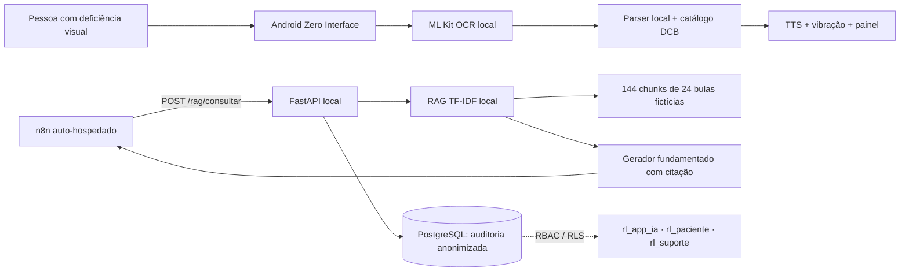

# Arquitetura executada — GuiaMed

Esta é a arquitetura realmente implementada e testada na V1. Nenhum SaaS ou
modelo remoto participa do fluxo.

## Fluxo principal do aplicativo

O APK funciona sem computador ou internet. CameraX captura a imagem, o ML Kit
reconhece o texto no próprio aparelho e o parser local identifica medicamento,
dosagem e validade. Alergias ficam no armazenamento privado do Android. O
backend acadêmico não é necessário para o funcionamento da V1.

## Fluxo acadêmico de IA e integração

1. O workflow [`n8n/workflows/guiamed_local_rag.json`](../n8n/workflows/guiamed_local_rag.json)
   executa manualmente 5 nós em sequência (`Iniciar evidência` → `Gerar RAG v1` →
   `Validar v1` → `Gerar RAG v2` → `Validar v2`), enviando a mesma pergunta fictícia
   para `POST /rag/consultar` com `prompt_version` `v1` e `v2`.
2. `backend/local_rag.py` divide as 24 bulas fictícias em 144 chunks — uma
   seção completa por chunk — e executa a busca TF-IDF por seção.
3. `backend/rag_llm.py` carrega de forma lazy e offline o modelo base
   `HuggingFaceTB/SmolLM2-135M-Instruct` (sem usar o adaptador LoRA de OCR) e gera
   a resposta em thread separada via `model.generate` com decodificação extrativa
   restrita (`extractive_trie`) sobre prefixos de sentenças dos chunks recuperados
   (e chunk integral em `#posologia`).
4. Toda resposta aceita termina com fonte verificável (`medicamento#seção`); sem
   medicamento/evidência suficiente (`refusal_no_evidence`) ou diante de padrão
   hostil reconhecido (`refusal_hostile`), o sistema recusa antes do modelo. Em
   falha, timeout ou saída não verificada, devolve `fallback_template` explícito.
5. O backend registra identificador anonimizado, impressão digital da consulta,
   fontes e metadados de execução (`busca_ms`, `geracao_ms`, `load_ms`, `total_ms`,
   `input_tokens`, `output_tokens`, `mode`, `decoding`, `geracao_llm_real`,
   `custo_usd=0.0` apenas para APIs externas). Texto livre, prompt e `raw_response`
   não são gravados na auditoria nem nos logs.

O registro histórico anterior (workflow de 3 nós com gerador determinístico) está
em [`evidencias/n8n/execucao_workflow_banco.txt`](../evidencias/n8n/execucao_workflow_banco.txt).

## Prompts versionados e comparação pareada

- [`prompts/v1.md`](../prompts/v1.md): baseline extrativo breve, com seção
  executável isolada por `EXECUTABLE_PROMPT_BEGIN/END`.
- [`prompts/v2.md`](../prompts/v2.md): trata consulta/trechos como dados JSON não
  confiáveis, exige preservação literal de números/negações e fonte obrigatória.
- [`prompts/CHANGELOG.md`](../prompts/CHANGELOG.md): diferenças entre versões.

Ambos os prompts são avaliados com os mesmos `hits` congelados e os mesmos
guardrails por [`scripts/compare_rag_prompts.py`](../scripts/compare_rag_prompts.py)
sobre [`data/qa/rag_prompt_comparison.json`](../data/qa/rag_prompt_comparison.json),
com evidências registradas em
[`evidencias/ia/rag_prompt_comparison/`](../evidencias/ia/rag_prompt_comparison/).

## Fine-tuning local de LLM

O experimento de fine-tuning usa SmolLM2-135M-Instruct com LoRA nas projeções
de atenção. A tarefa é retornar o nome comercial fictício a partir de OCR
ruidoso. O script compara geração livre do modelo original e do modelo ajustado
nas mesmas 48 entradas de teste, separadas dos 252 exemplos de treino.
Os resultados, parâmetros e respostas estão em
[`evidencias/ia/finetuning/`](../evidencias/ia/finetuning/).
O treino é executado na CPU local e o adaptador é salvo em
`models/ocr-smollm2-lora/`. Esse experimento acadêmico é executado pelo script
`scripts/run_llm_finetuning.py`.

## Experimento anterior de classificação

O experimento anterior ajusta um classificador Naive Bayes de n-gramas de
caracteres para identificar medicamentos em OCR ruidoso:

- 300 exemplos sintéticos e rotulados;
- 240 para treino e 60 para teste;
- 24 classes, correspondentes às bulas fictícias;
- baseline por correspondência exata: **80%**;
- modelo ajustado: **100%** no conjunto de teste;
- ganho: **20 pontos percentuais**.

O script reproduzível é
[`scripts/run_ai_evidence.py`](../scripts/run_ai_evidence.py), o dataset está em
[`data/ft/ocr_finetuning_local.jsonl`](../data/ft/ocr_finetuning_local.jsonl) e
o relatório está em
[`evidencias/ia/experimento_ajuste_local.md`](../evidencias/ia/experimento_ajuste_local.md).

## Casos, custo e latência

Os cinco casos iniciais estão em [`evidencias/ia/casos_teste.md`](../evidencias/ia/casos_teste.md)
e o benchmark pareado `v1` vs `v2` com `SmolLM2-135M-Instruct` está em
[`evidencias/ia/rag_prompt_comparison/comparison.md`](../evidencias/ia/rag_prompt_comparison/comparison.md)
e [`results.json`](../evidencias/ia/rag_prompt_comparison/results.json):

- `v1`: 9 chamadas `llm_grounded`, mediana de geração `7,11 s` (p95 `9,89 s`),
  `2568` tokens de entrada / `477` de saída; errou a seção em `RAG-03` (*Cardiovast*
  interações, 0/3).
- `v2`: 9 chamadas `llm_grounded`, mediana de geração `7,10 s` (p95 `12,07 s`),
  `3495` tokens de entrada / `576` de saída; acertou `RAG-01`, `RAG-02` e `RAG-03`
  (3/3).
- `RAG-04` (sem evidência) e `RAG-05` (injeção hostil) foram recusados antes do
  modelo em 3/3 repetições.
- `custo_usd = 0,00` mede exclusivamente cobrança de APIs externas; energia e
  hardware não foram medidos (há apenas estimativa de cenário em `results.json`).

## Limitações

- O conjunto sintético é pequeno e o resultado de 100% no classificador NB não deve
  ser generalizado para fotos reais.
- O modelo base `SmolLM2-135M-Instruct` não sustentou paráfrase livre confiável em
  português; por isso o RAG usa decodificação extrativa restrita (`extractive_trie`),
  o que reduz diferenças superficiais de formatação entre `v1` e `v2`, e exige carga
  fria em CPU (~7–10 s) acima de orçamentos móveis curtos.
- OCR de caligrafia, reflexo e desfoque continuam sendo os maiores riscos.
- A informação é didática e não substitui médico ou farmacêutico.
