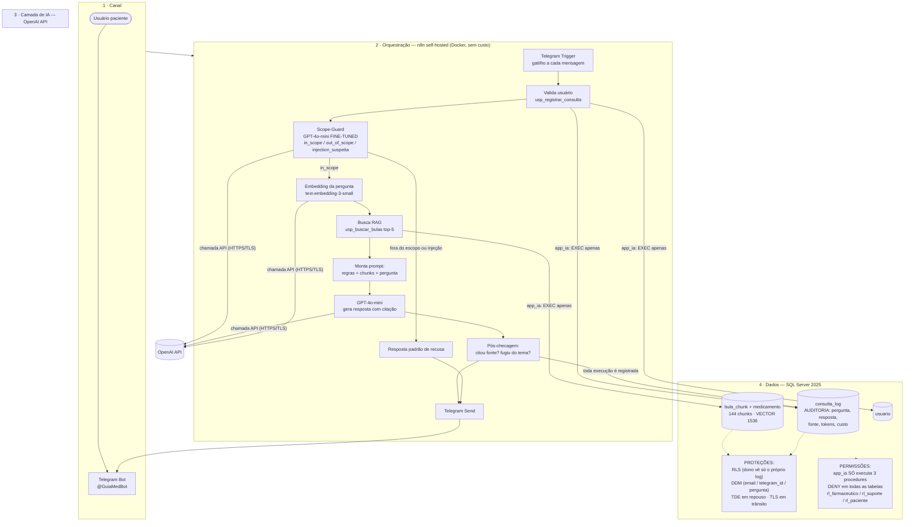

# Arquitetura — GuiaMed (diagrama único IA + dados)

Diagrama único exigido pela **Parte de integração**: banco ligado ao LLM, ao RAG e ao n8n, mostrando onde ficam **permissões (RBAC)**, **proteção de dados** e **auditoria**.

## Componentes (o que cada caixa faz e por quê)

| Componente | Escolha | Por quê |
|---|---|---|
| Interface | **Bot Telegram** | Permitido pelo enunciado; zero custo; demo ao vivo em aula; sem front-end para construir |
| Orquestração | **n8n self-hosted** (Docker) | Exigido pela disciplina; gratuito; nós nativos de Telegram, OpenAI e SQL Server; cada execução vira registro |
| LLM principal | **GPT-4o-mini** | Ver justificativa e custo abaixo |
| Scope-Guard | **GPT-4o-mini fine-tuned** | Classificador de escopo/injeção — ver experimento de fine-tuning abaixo |
| Embeddings | **text-embedding-3-small** (1536 dims) | Mais barato da OpenAI; qualidade suficiente para 144–200 chunks; custo da base ≈ US$ 0,001 |
| Banco / vetorial | **SQL Server 2025** (`VECTOR` + `VECTOR_DISTANCE`) | Um banco só para transacional + vetorial + auditoria; atende à disciplina de BD (TDE, DDM, RLS nativos) |
| Registro | `dbo.consulta_log` via `usp_registrar_consulta` | Toda mensagem (respondida ou recusada) fica auditável com fonte, tokens e custo |

## RAG em detalhe

| Etapa | Decisão | Justificativa |
|---|---|---|
| Fontes | 24 bulas fictícias (`data/bulas_md`, espelho de `data/bulas.json`) | Base controlada, sem dado sensível — ver [dados.md](dados.md) |
| Chunking | **1 chunk = 1 seção da bula** (144 chunks, ~400–700 caracteres) | Seção de bula é unidade semântica completa; chunking por tamanho fixo cortaria frases como "NUNCA usar diariamente" ao meio |
| Embeddings | text-embedding-3-small, 1536 dims | US$ 0,02/1M tokens — base inteira custa frações de centavo |
| Banco vetorial | coluna `VECTOR(1536)` em `bula_chunk`, similaridade `VECTOR_DISTANCE('cosine', ...)` | Vetor junto do dado: mesma linha tem texto, seção e medicamento (filtro relacional + vetorial numa query só) |
| Busca | `usp_buscar_bulas`: top-5 por cosseno, pré-filtro opcional por medicamento quando o nome aparece na pergunta | Pré-filtro seletivo reduz varredura (é também o gargalo medido na otimização — ver [seguranca.md](seguranca.md)) |
| Anti-alucinação | Prompt manda responder **só com os chunks**; pós-checagem exige citação `medicamento#seção` presente nos ids recuperados; se falhar → resposta padrão | Regra "sem fonte, sem resposta" |

## Experimento de fine-tuning (Scope-Guard)

| Item | Decisão |
|---|---|
| Tarefa | Classificação de cada mensagem em **3 classes**: `in_scope`, `out_of_scope`, `injection_suspeita` |
| Dados | **240 exemplos sintéticos rotulados pelo grupo** (80 por classe) em JSONL — amostra real em [`data/ft/scope_guard_amostra.jsonl`](../data/ft/scope_guard_amostra.jsonl); gerados com variações de gíria, erro de digitação e 15 padrões de injection do [plano de ataques](ataques.md) |
| Modelo base | `gpt-4o-mini` (fine-tuning supervisionado OpenAI, 3 épocas) |
| Métrica | **F1 macro** no conjunto de teste (60 exemplos separados, nunca vistos no treino) + taxa de injeção bloqueada; meta: F1 ≥ 0,95 |
| Custo do experimento | 240 ex × ~200 tok × 3 épocas ≈ 144k tokens × US$ 3/1M = **≈ US$ 0,43** (uma vez) |
| Fallback | Se o fine-tuned falhar na meta, volta para GPT-4o-mini com prompt de classificação (zero-shot) — já medido como baseline |

## Fluxo no n8n (gatilho → IA → ação → registro)

1. **Gatilho:** nó *Telegram Trigger* recebe a mensagem.
2. **Validação/registro inicial:** *SQL node* chama `usp_registrar_consulta` (cria usuário se novo, abre o log).
3. **IA 1 — Scope-Guard:** nó *OpenAI* com o modelo fine-tuned classifica a mensagem.
4. **Decisão:** nó *IF* — fora de escopo/injeção → resposta padrão de recusa; no escopo → segue.
5. **IA 2 — Embedding + RAG:** nó *OpenAI* (embedding) → *SQL node* (`usp_buscar_bulas`, top-5).
6. **IA 3 — Resposta:** nó *OpenAI* (GPT-4o-mini) com prompt montado (regras + chunks + pergunta).
7. **Ação:** nó *Telegram Send* com a resposta + citação da fonte + aviso de tarja.
8. **Registro final:** *SQL node* atualiza o log (resposta, chunks usados, tokens, custo).

## Escolha do LLM (justificada) e custo por 1.000 usos

| Critério | GPT-4o-mini ✅ | GPT-4o | Claude Haiku | Llama 3.1 8B (Ollama local) |
|---|---|---|---|---|
| Qualidade em PT-BR + segue instruções | Boa | Ótima | Boa | Média (precisa prompt maior) |
| Custo (input/1M, output/1M) | **$0,15 / $0,60** | $2,50 / $10 | $0,80 / $4 | $0 (hardware próprio) |
| Privacidade | API (dados fictícios; OpenAI não treina com dados de API paga) | idem | idem | **Máxima** (nada sai da máquina) |
| Latência | Baixa | Média | Baixa | Depende do PC |
| Fine-tuning barato | **Sim ($3/1M tok)** | Caro | Não nativo | Local (complexo) |

**Decisão:** GPT-4o-mini — a resposta do GuiaMed é curta e baseada em RAG, então um modelo "grande" não agrega; custo por uso ≈ **28× menor** que GPT-4o. Plano B documentado: Ollama + Llama 3.1 8B se a disciplina exigir demonstração com privacidade total (mesma arquitetura, trocando o nó do n8n).

**Estimativa por 1.000 usos** (preços públicos da OpenAI, sujeitos a atualização; 1 uso = fluxo completo):

| Etapa | Tokens/uso | Cálculo | Custo/1.000 usos |
|---|---|---|---|
| Scope-Guard (fine-tuned) | ~120 in / ~8 out | 120k×$0,30/1M + 8k×$1,20/1M | $0,046 |
| Embedding da pergunta | ~40 | 40k×$0,02/1M | $0,001 |
| Resposta (GPT-4o-mini) | ~1.600 in (prompt + 5 chunks) / ~250 out | 1,6M×$0,15/1M + 0,25M×$0,60/1M | $0,390 |
| **Total** | | | **≈ US$ 0,44 (~R$ 2,50)** |

Custos únicos de preparação: embeddings das 144 chunks (~$0,001) + treino do fine-tuning (~$0,43). Infra de dev (n8n + SQL Server em Docker, Telegram API): **$0**.
