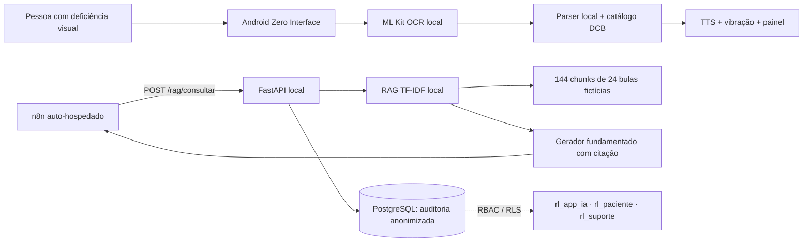

# Arquitetura executada — GuiaMed

Esta é a arquitetura realmente implementada e testada na V1. Nenhum SaaS ou
modelo remoto participa do fluxo.

## Fluxo principal do aplicativo

O APK funciona sem computador ou internet. CameraX captura a imagem, o ML Kit
reconhece o texto no próprio aparelho e o parser local identifica medicamento,
dosagem e validade. Alergias ficam no armazenamento privado do Android. O
backend acadêmico não é necessário para o funcionamento da V1.

## Fluxo acadêmico de IA e integração

1. O workflow [`n8n/workflows/guiamed_local_rag.json`](../n8n/workflows/guiamed_local_rag.json)
   recebe uma execução manual reproduzível.
2. O nó HTTP chama `POST /rag/consultar` na API FastAPI local.
3. `backend/local_rag.py` divide as 24 bulas fictícias em 144 chunks — uma
   seção completa por chunk.
4. A busca TF-IDF retorna os chunks mais relevantes e o gerador determinístico
   reproduz somente conteúdo recuperado.
5. Toda resposta válida termina com uma fonte no formato
   `medicamento#seção`; sem fonte suficiente, o sistema recusa responder.
6. O backend registra identificador anonimizado, impressão digital da consulta,
   fontes, horário, latência e custo. O texto livre e o `device_id` original não
   são persistidos na auditoria.

A execução real está em
[`evidencias/n8n/execucao_workflow_banco.txt`](../evidencias/n8n/execucao_workflow_banco.txt):
os três nós terminaram com `executionStatus: success` e o último nó retornou
`status_evidencia: PASSOU`.

## Prompts versionados

- [`prompts/v1.md`](../prompts/v1.md): versão inicial, sem citação obrigatória.
- [`prompts/v2.md`](../prompts/v2.md): fonte obrigatória, recusa segura e texto
  OCR tratado como dado não confiável.
- [`prompts/CHANGELOG.md`](../prompts/CHANGELOG.md): diferenças entre versões.

O prompt v2 é aplicado por um gerador determinístico local, eliminando risco de
alucinação e custo de API.

## Fine-tuning local de LLM

O experimento de fine-tuning usa SmolLM2-135M-Instruct com LoRA nas projeções
de atenção. A tarefa é retornar o nome comercial fictício a partir de OCR
ruidoso. O script compara geração livre do modelo original e do modelo ajustado
nas mesmas 48 entradas de teste, separadas dos 252 exemplos de treino.
Os resultados, parâmetros e respostas estão em
[`evidencias/ia/finetuning/`](../evidencias/ia/finetuning/).
O treino é executado na CPU local e o adaptador é salvo em
`models/ocr-smollm2-lora/`. Esse experimento acadêmico é executado pelo script
`scripts/run_llm_finetuning.py`.

## Experimento anterior de classificação

O experimento anterior ajusta um classificador Naive Bayes de n-gramas de
caracteres para identificar medicamentos em OCR ruidoso:

- 300 exemplos sintéticos e rotulados;
- 240 para treino e 60 para teste;
- 24 classes, correspondentes às bulas fictícias;
- baseline por correspondência exata: **80%**;
- modelo ajustado: **100%** no conjunto de teste;
- ganho: **20 pontos percentuais**.

O script reproduzível é
[`scripts/run_ai_evidence.py`](../scripts/run_ai_evidence.py), o dataset está em
[`data/ft/ocr_finetuning_local.jsonl`](../data/ft/ocr_finetuning_local.jsonl) e
o relatório está em
[`evidencias/ia/experimento_ajuste_local.md`](../evidencias/ia/experimento_ajuste_local.md).

## Casos, custo e latência

Os cinco casos com entrada, esperado e obtido estão em
[`evidencias/ia/casos_teste.md`](../evidencias/ia/casos_teste.md). Todos passaram.
Em 100 execuções locais, a medição registrada em
[`evidencias/ia/metricas.json`](../evidencias/ia/metricas.json) mostrou latência
média inferior a 1 ms para o RAG em memória e custo monetário de **US$ 0,00**.

## Limitações

- O conjunto sintético é pequeno e o resultado de 100% não deve ser
  generalizado para fotos reais.
- OCR de caligrafia, reflexo e desfoque continuam sendo os maiores riscos.
- A informação é didática e não substitui médico ou farmacêutico.
